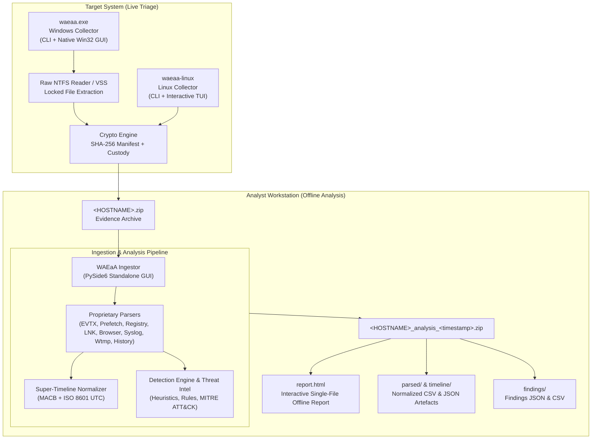

# WAEaA &mdash; Windows Artifacts Extractor and Analyzer

[](https://github.com/Cybsquatch/WAEaA/actions/workflows/ci.yml)
[](https://github.com/Cybsquatch/WAEaA)
[](https://golang.org)
[](https://python.org)
[](LICENSE)
[](#internationalization)

**WAEaA** (*Windows Artifacts Extractor and Analyzer*) is an enterprise-grade, high-performance digital forensics and incident response (DFIR) toolkit. Designed for CSIRT, SOC, and forensic practitioners, WAEaA provides legally sound, forensically verifiable triage collection and automated deep analysis with **zero external binary dependencies** and **100% offline capability**.

---

## Key Capabilities

* **Single-Binary Zero-Dependency Collectors:**
  * **Windows:** A single executable (`waeaa.exe`) delivering both a command-line interface and a native Win32 graphical user interface, featuring automatic UAC elevation.
  * **Linux:** A single static executable (`waeaa-linux-*`) providing CLI and an interactive terminal user interface (TUI) with automatic distribution detection.
* **Forensic Soundness & Locked File Handling:**
  * Proprietary raw NTFS filesystem reader accessing low-level disk clusters directly to acquire actively locked system files (`$MFT`, locked Registry hives, active Event Logs) with `SeBackupPrivilege`.
  * Transparent fallback to Volume Shadow Copies (VSS) when required.
  * SHA-256 cryptographic hashing of every acquired artefact with full manifest and immutable chain of custody recording.
* **Comprehensive Multi-Platform Parsing Engine:**
  * Proprietary, clean-room binary parsers: Windows Event Logs (`.evtx`), SCCA & MAM compressed Prefetch (`.pf`), Registry Hives (`regf`/`nk`/`vk`), Shell Links (`.lnk`), Browser SQLite history, Linux `syslog`/`auth.log`, 384-byte `utmp`/`wtmp` records, user shell history (`.bash_history`, `.zsh_history`), and scheduled cron jobs.
* **Integrated Threat Detection Engine & MITRE ATT&CK Mapping:**
  * Proprietary rule engine detecting credential dumping (LSASS access, `sekurlsa`), anti-forensics (log clearing Event 1102/104), living-off-the-land binaries (LOLBins), suspicious PowerShell execution, persistence mechanisms, and interactive reverse shells.
  * Curated offline threat intelligence matching known malicious hashes (SHA-256), suspicious C2 addresses, and vulnerable driver signatures (BYOVD).
* **Interactive Standalone HTML Report:**
  * Self-contained, single-file offline HTML report with embedded responsive dark-theme CSS and vanilla JavaScript. Features executive metrics, MITRE ATT&CK matrix view, instant full-text search, severity filtering, super-timeline exploration, and client-side CSV export without external CDN dependencies.
* **Strict Legal & Commercial Compliance:**
  * Clean-room implementation with zero third-party tool dependencies. Runtime dependencies use only commercial-friendly permissive licenses (MIT, BSD, Apache-2.0, LGPL dynamic linking).

---

## Architecture Overview



---

## Toolkit Components

| Component | Target Platform | Interface | Primary Purpose |
|---|---|---|---|
| **Windows Collector** (`waeaa.exe`) | Windows 10, 11, Server 2016 &mdash; 2025 | CLI + Win32 GUI | High-speed triage collection of locked system artefacts into `<HOSTNAME>.zip`. |
| **Legacy Windows Collector** (`waeaa-legacy.exe`) | Windows 7, 8, 8.1, Server 2008 R2 &mdash; 2012 R2 | CLI + Win32 GUI | Dedicated build with legacy OS support and identical forensic rule coverage. |
| **Linux Collector** (`waeaa-linux-*`) | Debian, Ubuntu, RHEL, CentOS, Rocky, Alma, SUSE, Arch, Amazon Linux | CLI + Terminal TUI | Distro-aware acquisition of logs, configs, user histories, and process states. |
| **WAEaA Ingestor** (`waeaa-ingestor`) | Analyst Workstation (Windows / Linux) | Qt / PySide6 GUI | Parsing, super-timeline generation, threat detection, and offline HTML reporting. |

---

## Supported Forensic Artefacts

### Windows Artefacts
* **Event Logs:** `System`, `Security`, `Application`, `PowerShell/Operational`, `TaskScheduler`, `TerminalServices`, `DNS-Client`, `WMI-Activity`, `Sysmon`.
* **File Execution & Cache:** SCCA & MAM compressed Prefetch (`.pf`), Shimcache / AppCompatCache, Amcache (`Amcache.hve`), Shell Link shortcuts (`.lnk`), Jump Lists (`AutomaticDestinations`, `CustomDestinations`).
* **Registry Hives:** `SYSTEM`, `SOFTWARE`, `SAM`, `SECURITY`, `DEFAULT`, `NTUSER.DAT`, `UsrClass.dat` (Run/RunOnce keys, Services, User Accounts, USBSTOR, Shellbags).
* **Filesystem & Volume:** Raw `$MFT` ($MasterFileTable), `$LogFile`, `$Boot`, locked volume structures, Volume Shadow Copies.
* **Web Browsers:** Chromium-based (Google Chrome, Microsoft Edge, Brave) and Mozilla Firefox history and download databases.
* **Persistence & Tasks:** Scheduled Tasks XML (`System32\Tasks`), Startup folder items.

### Linux Artefacts
* **System & Auth Logs:** `/var/log/auth.log`, `/var/log/secure`, `/var/log/syslog`, `/var/log/messages`, `/var/log/audit/audit.log`, journald.
* **User Session History:** Login records (`/var/log/wtmp`, `/var/log/btmp`, `/var/run/utmp`), user shell histories (`.bash_history`, `.zsh_history`).
* **Persistence & Tasks:** System crontab (`/etc/crontab`), cron directories (`cron.*`), user spools (`/var/spool/cron/crontabs`), systemd unit files (`/etc/systemd/system`, `/lib/systemd/system`).
* **Network & Accounts:** `/etc/passwd`, `/etc/group`, `/etc/shadow`, `/etc/sudoers`, `/etc/hosts`, `/etc/resolv.conf`, `/etc/ssh/*`, SSH `authorized_keys`.
* **System Configuration:** Dynamic loader preload (`/etc/ld.so.preload`, `/etc/ld.so.conf`), installed packages, kernel modules.

---

## Quick Start

### 1. Windows Collector

Run `waeaa.exe` without arguments to launch the native GUI (requests elevation via UAC automatically), or run via elevated command prompt:

```cmd
:: Run standard incident triage collection
waeaa.exe -o E:\Evidence -r triage --authorized --case-id "INC-2026-001" --examiner "Analyst Doe"

:: Run collection with custom rules and debug logging
waeaa.exe -o E:\Evidence -r triage,windows.memory --debug

:: List available built-in collection rules
waeaa.exe --list-rules
```

#### Command-Line Flags (Windows Collector)
* `-o, --output <dir>`: Destination directory for the evidence ZIP archive (required in CLI mode).
* `-r, --rules <names>`: Comma-separated rule identifiers or categories (e.g. `triage`, `windows.eventlogs`).
* `--case-id <id>`: Case tracking identifier recorded in the chain of custody.
* `--examiner <name>`: Legal name or ID of the investigator performing the collection.
* `--description <desc>`: Description of the incident or triage purpose.
* `--authorized`: Confirms lawful authorization to collect evidence on the target system.
* `--no-ntfs`: Disables raw NTFS disk parsing, falling back to standard OS copy API.
* `--no-vss`: Disables Volume Shadow Copy fallback.
* `--lang <code>`: User interface language (`en`, `it`, `es`, `fr`, `de`).

---

### 2. Linux Collector

Run `waeaa-linux` without arguments as root to open the interactive terminal menu (TUI), or execute via command line:

```bash
# Run triage collection on Linux
sudo ./waeaa-linux-amd64 -o /mnt/usb/evidence -r linux.triage --authorized --case-id "INC-2026-001"

# List available Linux collection rules
./waeaa-linux-amd64 --list-rules
```

---

### 3. WAEaA Ingestor

The Ingestor runs on the forensic workstation to inspect and analyze the collected archive:

```powershell
# Launch the graphical application
waeaa-ingestor
```

1. Click **Open Archive...** and select `<HOSTNAME>.zip`.
2. Review target metadata and case information.
3. Click **Start Analysis**. The background worker will:
   * Verify all SHA-256 cryptographic hashes against the evidence manifest.
   * Parse all binary artefacts into normalized tabular models.
   * Generate a unified, chronologically sorted super-timeline (`super_timeline.csv` / `json`).
   * Evaluate forensic detection rules and threat intelligence indicators.
   * Compile the standalone, interactive offline `report.html`.
   * Package results into `<HOSTNAME>_analysis_<timestamp>.zip`.

---

## Detection Capabilities & MITRE ATT&CK Mapping

WAEaA incorporates a specialized detection engine that correlates indicators across multiple forensic artefacts:

| Rule Identifier | Severity | MITRE Tactic | Technique | Detection Scope |
|---|---|---|---|---|
| `waeaa.evtx.log_clearing` | **CRITICAL** | Defense Evasion | T1070.001 | Clearing of Security (1102) or System (104) event logs. |
| `waeaa.credential.dumping` | **CRITICAL** | Credential Access | T1003.001 | LSASS memory access, `procdump`, `comsvcs.dll`, `sekurlsa`. |
| `waeaa.ransomware.shadow_copy` | **CRITICAL** | Impact | T1490 | Execution of `vssadmin delete shadows`, `wmic shadowcopy delete`. |
| `waeaa.linux.reverse_shell` | **CRITICAL** | Execution | T1059.004 | Interactive shells redirecting sockets via `/dev/tcp`, `nc -e`, Python. |
| `waeaa.intel.known_hash` | **CRITICAL** | Execution | T1204.002 | SHA-256 matching known malware, webshells, or attack tools. |
| `waeaa.powershell.suspicious` | **HIGH** | Execution | T1059.001 | Obfuscated script blocks, download cradles (`DownloadString`, `IEX`). |
| `waeaa.evtx.suspicious_service` | **HIGH** | Persistence | T1543.003 | Service creation (7045) pointing to shells, scripts, or temp paths. |
| `waeaa.execution.lolbins` | **HIGH** | Defense Evasion | T1218 | Misuse of `certutil -urlcache`, `bitsadmin`, `mshta`, `regsvr32`. |
| `waeaa.persistence.registry_run` | **HIGH** | Persistence | T1547.001 | Run/RunOnce entries executing payloads from temporary directories. |
| `waeaa.linux.shadow_access` | **HIGH** | Credential Access | T1003.008 | Unauthorized reads or dumps of `/etc/shadow` via `sudo` or shell history. |
| `waeaa.intel.vulnerable_driver` | **HIGH** | Defense Evasion | T1068 | Known vulnerable drivers frequently abused in BYOVD attacks. |
| `waeaa.execution.temp_dir` | **MEDIUM** | Defense Evasion | T1036 | Binary execution launched from `\Temp`, `\AppData`, `/tmp`, `/dev/shm`. |

---

## Internationalization

WAEaA provides complete multilingual support across all interfaces and outputs:
* **English** (`en`) &mdash; Default
* **Italian** (`it`)
* **Spanish** (`es`)
* **French** (`fr`)
* **German** (`de`)

Language switches occur dynamically in the GUI and report outputs.

---

## Forensic Integrity & Chain of Custody

WAEaA generates an immutable forensic package:
* `_meta/manifest.json`: Lists every acquired artefact, original source filesystem path, byte size, modification timestamp, acquisition timestamp, and cryptographic hash (`sha256`, `sha1`, `md5`).
* `_meta/chain_of_custody.json`: Records host identification, operating system, network interfaces, investigator identification, case reference, lawful authorization acknowledgement, and exact collection UTC time range.
* `_meta/collection.log`: Detailed chronological execution log.

---

## Building from Source

### Prerequisites
* Go 1.20+ (for modern and legacy collector builds)
* Python 3.11+ (for Ingestor)
* GCC / MinGW (optional, for Linux cross-compilation)

### Build Collectors (Windows & Linux)
```powershell
# Build Windows collectors (modern and legacy)
.\scripts\build.ps1 -Version 1.0.0

# Or build manually using Go
cd collector
go build -trimpath -ldflags="-s -w" -o ../bin/waeaa.exe ./cmd/waeaa
```

### Build Ingestor Application
```powershell
cd ingestor
python -m venv .venv
.\.venv\Scripts\Activate.ps1
pip install -e ".[dev]"

# Run comprehensive test suite
pytest --cov=waeaa_ingestor

# Package standalone executable using PyInstaller
pyinstaller waeaa_ingestor.spec
```

---

## Legal & Compliance Notice

> [!IMPORTANT]
> **Authorized Use Only:** WAEaA is designed exclusively for authorized incident response, administrative triage, and forensic investigations. Use of this software on computer systems without explicit, lawful permission from the system owner is strictly prohibited. Collected forensic artefacts may contain sensitive or personal data; investigators must handle all generated archives in compliance with applicable privacy regulations (such as GDPR).

---

## License

Proprietary software. Copyright &copy; 2026 Riccardo Belli. All rights reserved.  
For third-party open-source components and licensing acknowledgements, refer to [THIRD_PARTY_NOTICES.md](THIRD_PARTY_NOTICES.md).
